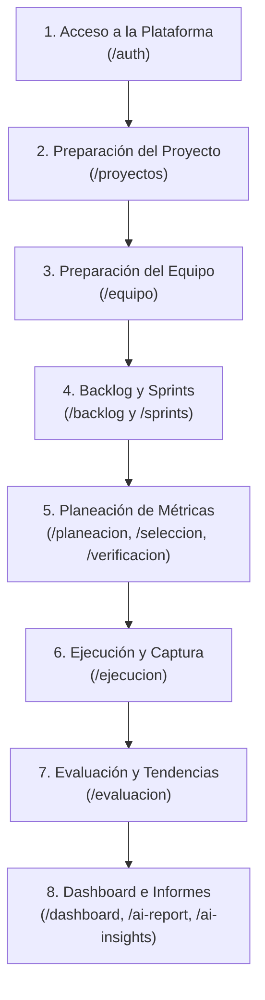

## Flujo Operativo Integral de PRODOX V1

PRODOX organiza la medición ágil a través de un recorrido estructurado donde cada etapa desbloquea la siguiente. Sigue esta guía para comprender cómo interactúan los módulos de la plataforma en un ciclo de trabajo real:

---

### Etapa 1: Acceso a la Plataforma

- **Propósito**: Autenticar al usuario de forma segura y habilitar el entorno de trabajo según sus credenciales.
- **Requisitos previos**: Correo electrónico corporativo o personal y contraseña segura.
- **Pasos principales**:
  1. Ingresar a `/auth` e introducir correo y contraseña en la pestaña de inicio de sesión.
  2. Si es un usuario nuevo, alternar a la pestaña de registro y crear la cuenta.
  3. En caso de olvido de credenciales, solicitar restablecimiento desde `/reset-password`.
- **Restricción comprobada**: El token JWT generado tiene una vigencia continua de 24 horas en `localStorage`.
- **Siguiente acción**: 👉 [Ir al inicio de sesión](/auth/login) o avanzar al [Listado de Proyectos](/proyectos/listado).

---

### Etapa 2: Preparación del Proyecto

- **Propósito**: Crear o seleccionar el espacio de trabajo activo que servirá de contexto para todos los módulos operativos.
- **Requisitos previos**: Haber iniciado sesión con éxito.
- **Pasos principales**:
  1. Acceder a `/proyectos` para visualizar el catálogo de proyectos existentes.
  2. Para trabajar en un proyecto existente, hacer clic en el botón **"Trabajar"** de su tarjeta; esto almacena el proyecto activo en `localStorage` (`mpdia_proyecto_activo`).
  3. Para iniciar un nuevo proyecto, desplegar el formulario con **"+ Nuevo Proyecto"**, definiendo nombre, metodología (`Scrum` o `XP`), duración del timebox, número de sprints y el *Product Goal*.
- **Restricción comprobada**: Los módulos internos (`/planeacion`, `/sprints`, `/backlog`, `/ejecucion`, etc.) están protegidos por `proyectoGuard` y requieren estrictamente tener un proyecto activo en estado `'activo'`.
- **Siguiente acción**: 👉 [Consultar Listado de Proyectos](/proyectos/listado) o [Crear Proyecto](/proyectos/crear).

---

### Etapa 3: Preparación del Equipo

- **Propósito**: Incorporar a los colaboradores al proyecto y asignarles los roles adecuados de acuerdo con el modelo de control de acceso (RBAC).
- **Requisitos previos**: Proyecto activo seleccionado por un usuario con rol de Scrum Master.
- **Pasos principales**:
  1. Navegar a `/equipo` para inspeccionar la nómina actual del proyecto.
  2. Hacer clic en **"Invitar miembro"** para generar un código alfanumérico único asociado a un rol propuesto.
  3. El colaborador invitado introduce dicho código desde el panel de unirse a proyecto para quedar vinculado de inmediato.
  4. El Scrum Master puede reasignar roles (`scrum_master`, `product_owner`, `scrum_member`) desde la tabla de integrantes.
- **Restricción comprobada**: Solo puede existir un único Scrum Master por proyecto activo; transferir dicho rol requiere confirmación explícita.
- **Siguiente acción**: 👉 [Ver Gestión de Equipo](/equipo/general) y [Matriz de Roles y Permisos](/equipo/roles-permisos).

---

### Etapa 4: Preparación del Backlog y los Sprints

- **Propósito**: Estructurar el trabajo funcional que entregará el equipo y planificar el calendario de iteraciones.
- **Requisitos previos**: Contar con Product Owner y Scrum Master configurados en el proyecto.
- **Pasos principales**:
  1. En `/backlog`, el Product Owner crea las historias de usuario con título, descripción en formato ágil, prioridad y estimación en Story Points (escala de Fibonacci).
  2. En `/sprints`, el Scrum Master supervisa el cronograma de sprints calculado según el timebox y gestiona sus estados (`PLANIFICADO`, `ACTIVO`, `COMPLETADO`, `REABIERTO`).
  3. Se inicia el primer sprint formal cuando las historias prioritarias están refinadas y las métricas quedan aprobadas.
- **Restricción comprobada**: La creación y edición del backlog es exclusiva del Product Owner (los demás roles tienen lectura). Solo puede haber 1 sprint en estado `ACTIVO` a la vez.
- **Siguiente acción**: 👉 [Gestión del Backlog](/backlog/general) y [Gestión de Sprints](/sprints/general).

---

### Etapa 5: Planeación de Métricas

- **Propósito**: Definir qué indicadores cuantitativos medirán la salud técnica, la productividad y el clima del equipo durante la iteración.
- **Requisitos previos**: Proyecto activo con sprints configurados.
- **Pasos principales**:
  1. En `/planeacion`, revisar los factores ágiles (Sociohumano, Calidad, Cumplimiento, Productividad) y el catálogo de variables.
  2. En `/seleccion`, transferir las métricas clave del catálogo al conjunto del sprint mediante el selector dual.
  3. En `/resumen-seleccion`, parametrizar cada métrica (fórmula, objetivo, escalas, periodicidad) apoyándose en el asistente GenAI.
  4. Enviar las propuestas al Scrum Master, quien desde `/verificacion` aprueba o devuelve las configuraciones.
  5. Si el equipo requiere un indicador no existente, formularlo mediante [Crear Métrica con IA](/planeacion/crear-metrica-ia).
- **Restricción comprobada**: Solo las métricas en estado **Aprobado** por el Scrum Master generan variables activas para ser capturadas en el módulo de Ejecución.
- **Siguiente acción**: 👉 [Explorar Planeación de Métricas](/planeacion/general).

---

### Etapa 6: Ejecución y Captura

- **Propósito**: Registrar oportunamente las mediciones cuantitativas en el sprint activo para alimentar el cálculo analítico.
- **Requisitos previos**: Sprint en curso o reabierto con métricas previamente aprobadas.
- **Pasos principales**:
  1. Ingresar a `/ejecucion` y seleccionar la iteración activa en el menú desplegable.
  2. Verificar en el gráfico de dona el porcentaje de recolección alcanzado (`X de Y métricas capturadas`).
  3. Abrir el formulario modal mediante el botón **"Registrar valor"** o editar lecturas previas con el icono de lápiz.
  4. Ingresar la fecha de observación, el valor cuantitativo y notas aclaratorias; guardar el registro.
- **Restricción comprobada**: Las variables de alcance individual pueden ser registradas por cualquier miembro; las de alcance grupal están reservadas al Scrum Master.
- **Siguiente acción**: 👉 [Guía de Ejecución y Captura](/ejecucion/general).

---

### Etapa 7: Evaluación y Tendencias

- **Propósito**: Auditar el desempeño histórico, comparar resultados entre sprints y detectar patrones matemáticos de mejora o riesgo.
- **Requisitos previos**: Existencia de al menos 1 registro de medición en el proyecto (recomendado $\ge 2$ sprints para comparativas).
- **Pasos principales**:
  1. Acceder a `/evaluacion` y elegir el sprint de análisis.
  2. En la pestaña **Tendencias**, consultar la media, rango y dispersión interna de cada métrica.
  3. En la pestaña **Comparación entre Sprints**, evaluar la matriz evolutiva y las tasas de variación porcentual (+/-%) ciclo a ciclo.
  4. En la pestaña **Estadísticas**, revisar las alertas automáticas de comportamiento (tendencias sostenidas a la baja o incrementos atípicos de variabilidad).
- **Restricción comprobada**: Se requieren mediciones en 2 o más fechas para proyectar tendencias intra-sprint, y al menos 2 iteraciones con datos para análisis de variabilidad.
- **Siguiente acción**: 👉 [Ir al Módulo de Evaluación](/evaluacion/general).

---

### Etapa 8: Dashboard e Informes

- **Propósito**: Proveer una vista ejecutiva integral en tiempo real y emitir reportes de nivel gerencial respaldados por Inteligencia Artificial.
- **Requisitos previos**: Mediciones acumuladas en los sprints del proyecto.
- **Pasos principales**:
  1. Visitar `/dashboard` para examinar los KPIs globales (Métricas activas, Riesgos detectados, Estado de sprints y Miembros).
  2. Analizar las curvas interactivas de evolución temporal y distribución por categorías generadas con Chart.js.
  3. Consultar **AI Insights** para recibir diagnósticos predictivos redactados por Google Gemini.
  4. Exportar el informe ejecutivo completo en formato Word editable (`.docx`) mediante la acción rápida de la barra superior.
  5. Activar el asistente de **Retrospectiva Inteligente** para orientar la sesión de mejora continua del equipo con dinámicas *Start/Stop/Continue*.
- **Restricción comprobada**: La generación de AI Insights exige un mínimo de 2 sprints finalizados formalmente en la base de datos.
- **Siguiente acción**: 👉 [Explorar Dashboard e Informes](/dashboard/general).

