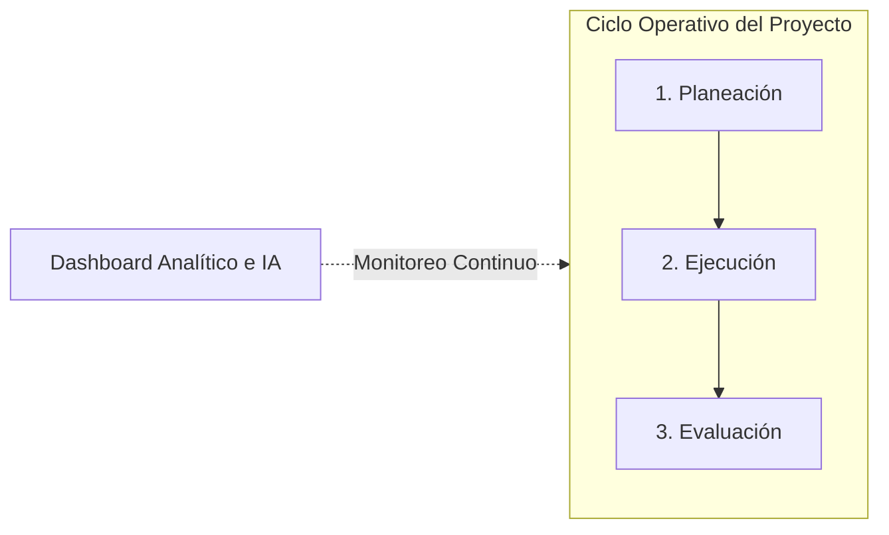

# Bienvenida y Modelo de Trabajo en PRODOX V1

Bienvenido a la documentación oficial de **PRODOX V1**, la plataforma de métricas de desarrollo ágil diseñada para respaldar la toma de decisiones basada en datos cuantitativos y análisis predictivo con Inteligencia Artificial.

---

## ¿Qué es PRODOX V1?

PRODOX es una herramienta orientada a equipos de software que utilizan marcos ágiles (principalmente **Scrum** y **Extreme Programming - XP**). Su objetivo principal es cerrar la brecha entre la gestión del trabajo cotidiano y la evaluación objetiva del desempeño, proporcionando:

- 📊 **Medición cuantitativa continua**: Captura sistemática de indicadores de calidad, velocidad, cumplimiento y dinámica sociohumana.
- 🎯 **Planeación metodológica estructurada**: Catálogo de factores y métricas, parametrización guiada con Inteligencia Artificial y aprobación formal del Scrum Master.
- 🔍 **Trazabilidad de mediciones**: Registro histórico auditable de variables por sprint y control de versiones de métricas.
- 📈 **Analítica de tendencias**: Comparación transversal entre iteraciones, análisis de dispersión y detección matemática de variabilidad.
- 🤖 **Inteligencia Artificial integrada**: Modelos generativos (Google Gemini) que emiten diagnósticos predictivos (*AI Insights*), redacción de reportes ejecutivos descargables en Word (`.docx`) y dinámicas de retrospectiva basadas en evidencia.

---

## Modelo Metodológico: Las Tres Fases de PRODOX

A diferencia de las herramientas genéricas de seguimiento de tareas, PRODOX estructura el ciclo de vida del proyecto en **tres fases operativas secuenciales**, supervisadas permanentemente por un tablero analítico central:

1. **Fase de Planeación (`/planeacion`)**:
   El equipo selecciona qué dimensiones metodológicas se evaluarán, parametriza las variables técnicas mediante asistencia GenAI y somete las propuestas al Scrum Master para su aprobación y versionado formal.
2. **Fase de Ejecución (`/ejecucion`)**:
   Durante el sprint activo, los integrantes del equipo capturan periódicamente los valores de las variables individuales asignadas, mientras el Scrum Master consolida los registros de alcance grupal.
3. **Fase de Evaluación (`/evaluacion`)**:
   Una vez concluidas las iteraciones o durante sprints en revisión, el sistema procesa los datos para proyectar tendencias intra-sprint, matrices comparativas históricas y cálculos estadísticos de variabilidad.
4. **Supervisión Transversal (`/dashboard`)**:
   Unifica KPIs en tiempo real, alertas preventivas de riesgo, feed de actividad e informes exportables para stakeholders.

---

## Perfiles de Usuario y Alcance Operativo

PRODOX aplica un modelo de control de acceso basado en roles (RBAC) específico por cada proyecto activo:

### 🔵 Scrum Master (Líder Metodológico)
Es el responsable de la disciplina del proceso y la salud del proyecto:
- Crea y configura el proyecto ágil y su horizonte de iteraciones.
- Aprueba o devuelve las parametrizaciones de métricas en la bandeja de verificación.
- Administra el ciclo de vida de los sprints (apertura, cierre y reapertura).
- Genera códigos de invitación para incorporar miembros y asigna roles en el equipo.
- Exporta expedientes ejecutivos en Word (`.docx`) y conduce retrospectivas con IA.

### 🟢 Product Owner (Gestor del Valor)
Es el propietario de la visión y priorización del producto:
- Define y ajusta el *Product Goal* del proyecto.
- Posee control exclusivo sobre el **Product Backlog** (`/backlog`): crea, edita, estima con Story Points y prioriza historias de usuario.
- Propone métricas clave y colabora en la parametrización de objetivos.
- Monitorea el ritmo de entrega y cumplimiento en el Dashboard analítico.

### ⚪ Scrum Member (Equipo de Desarrollo)
Desarrolladores, analistas de pruebas (QA), diseñadores y especialistas técnicos:
- Consultan el backlog priorizado y el calendario de sprints planificados.
- Registran oportunamente los valores de las variables individuales en el módulo de Ejecución.
- Consultan su historial de mediciones y analizan las tendencias en el módulo de Evaluación.
- Participan activamente en las retrospectivas inteligentes generadas por la plataforma.

---

## Cómo Continuar

Para iniciar el recorrido de configuración y operación de PRODOX V1:

1. Revisa los requisitos de navegador, red y resolución en [Requisitos del Sistema](/inicio/requisitos).
2. Si ya cuentas con tu entorno preparado, procede directamente a la etapa de [Acceso a la Plataforma e Inicio de Sesión](/auth/login).
